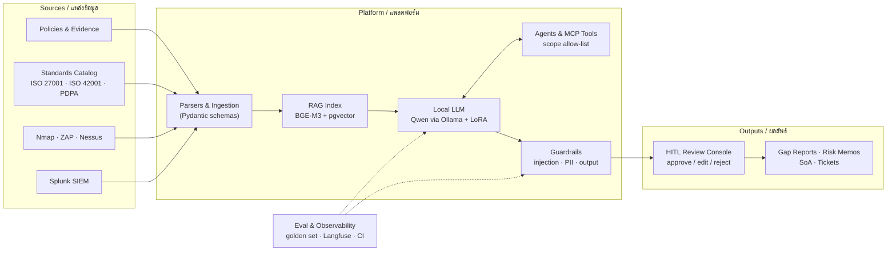

# 🛡️ AI Security & ISO Compliance Automation Platform


-success)


**🇹🇭 [ภาษาไทย](#-ภาษาไทย)** · **🇬🇧 [English](#-english)** · [Architecture](#-สถาปัตยกรรม--architecture) · [Progress](#-ความคืบหน้า--progress-tracker) · [Final Projects](#-final-projects)

---

## 🇹🇭 ภาษาไทย

### ภาพรวม

Repo นี้เก็บงานทั้งหมดของการสร้าง **End-to-End Local AI Security & ISO Compliance Automation Platform** ระบบที่ใช้ Local LLM ทำงานด้าน GRC และ Security แบบอัตโนมัติ โดยข้อมูลไม่ต้องออกนอกองค์กร ได้แก่

- **Automated Gap Analysis** เทียบนโยบายองค์กรกับ ISO/IEC 27001, ISO/IEC 42001 และ PDPA พร้อมอ้างอิงข้อความระดับย่อหน้า
- **Vulnerability-to-Risk** แปลงผลสแกน (Nmap, OWASP ZAP, Nessus) และ log จาก SIEM (Splunk) เป็นความเสี่ยงทางธุรกิจที่ผู้บริหารตัดสินใจได้
- **AI Red Teaming & Guardrails** ทดสอบเจาะและป้องกันตัวระบบ AI เอง ตาม OWASP Top 10 for LLM และ ISO/IEC 42001

งานแบ่งเป็น 8 ช่วง (Phase 0–7) แต่ละช่วงเพิ่มโมดูลใหม่ให้แพลตฟอร์ม และมีโจทย์ 5 บทบาท ได้แก่ SOC, Pentest, Consult, Engineer และ Applied

### หลักการทำงาน

1. **Local-first** ใช้ Qwen ผ่าน Ollama เป็นหลัก API ภายนอกใช้เพื่อเทียบผลเท่านั้น
2. **Evaluation ก่อนอ้างผล** ทุกตัวเลขใน README มาจาก script ใน repo ที่รันซ้ำได้
3. **Human-in-the-Loop** รายงานและการเปลี่ยนค่า config ต้องผ่านคนอนุมัติก่อนเสมอ
4. **Vibe coding อย่างมีวินัย** ใช้ AI ช่วยเขียนโค้ดได้ แต่ต้องอ่าน อธิบาย และมี test ครอบทุกส่วน

### เริ่มต้นใช้งาน

```bash
git clone https://github.com/anaphat/ai-sec-platform.git
cd ai-sec-platform
python -m venv .venv
source .venv/bin/activate          # Windows: .venv\Scripts\activate
pip install -r requirements.txt
cp .env.example .env               # ใส่ค่า config ใน .env (ไฟล์นี้ไม่ขึ้น git)
ollama pull qwen2.5:7b             # หรือรุ่น Qwen ที่เครื่องรองรับ
pytest                             # ตรวจว่าทุกอย่างทำงาน
```

### วิธีทำโจทย์แต่ละข้อ

แต่ละโจทย์มีโฟลเดอร์ของตัวเองในรูปแบบ `phase-<เลขช่วง>/<บทบาท>-<a|b>` เช่น `phase-0/soc-a`

```bash
git pull                                   # ดึงงานล่าสุดก่อนเริ่มทุกครั้ง
mkdir -p phase-0/soc-a && cd phase-0/soc-a
# ... เขียนโค้ด ข้อมูลทดสอบ และ README.md ของโจทย์ ...
git add .
git commit -m "phase 0 soc-a: แปลง SIEM log เป็นข้อมูลพร้อมวิเคราะห์"
git push
```

ดึงเฉพาะโฟลเดอร์ของโจทย์ใดโจทย์หนึ่งลงอีกเครื่อง:

```bash
git clone --filter=blob:none --sparse https://github.com/anaphat/ai-sec-platform.git
cd ai-sec-platform
git sparse-checkout set phase-0/soc-a
```

### นโยบายข้อมูลและความปลอดภัย

- ใช้**ข้อมูลจำลอง**หรือเอกสารสาธารณะเท่านั้น ห้ามมีข้อมูลลูกค้า ข้อมูลส่วนบุคคล หรือ log จากระบบจริง
- เก็บ API key และรหัสผ่านใน `.env` เท่านั้น และสแกนด้วย `gitleaks detect` ก่อน push
- การทดสอบเจาะทุกโจทย์ทำใน **lab ของตัวเอง** หรือ scope ที่ได้รับอนุญาตเป็นลายลักษณ์อักษรเท่านั้น
- ข้อความเต็มของมาตรฐาน ISO มีลิขสิทธิ์ ใน repo นี้ใช้เฉพาะรหัสและชื่อ control กับคำอธิบายที่เขียนเอง

---

## 🇬🇧 English

### Overview

This repository contains the full build of an **End-to-End Local AI Security & ISO Compliance Automation Platform**, a system that uses local LLMs to automate GRC and security work without sending data outside the organization:

- **Automated Gap Analysis** of organizational policies against ISO/IEC 27001, ISO/IEC 42001 and Thailand’s PDPA, with paragraph-level citations
- **Vulnerability-to-Risk** translation of scan results (Nmap, OWASP ZAP, Nessus) and SIEM logs (Splunk) into business risk that executives can act on
- **AI Red Teaming & Guardrails** that test and protect the AI system itself, aligned with the OWASP Top 10 for LLM Applications and ISO/IEC 42001

The work is organized into 8 phases (Phase 0–7). Each phase adds a module to the platform and includes challenges across five roles: SOC, Pentest, Consult, Engineer and Applied.

### Principles

1. **Local-first:** Qwen via Ollama is the default model; external APIs are used only as baselines.
2. **Evaluate before claiming:** every number in this README is produced by a reproducible script in the repo.
3. **Human-in-the-Loop:** reports and configuration changes always require human approval.
4. **Disciplined vibe coding:** AI-assisted code is welcome, but every part must be read, explained and covered by tests.

### Getting started

```bash
git clone https://github.com/anaphat/ai-sec-platform.git
cd ai-sec-platform
python -m venv .venv
source .venv/bin/activate          # Windows: .venv\Scripts\activate
pip install -r requirements.txt
cp .env.example .env               # put your settings in .env (never committed)
ollama pull qwen2.5:7b             # or any Qwen model your hardware supports
pytest                             # verify everything works
```

### Working on a challenge

Each challenge lives in its own folder named `phase-<number>/<role>-<a|b>`, for example `phase-0/soc-a`.

```bash
git pull                                   # always pull before starting
mkdir -p phase-0/soc-a && cd phase-0/soc-a
# ... write code, test data and the challenge README.md ...
git add .
git commit -m "phase 0 soc-a: SIEM log summary pipeline"
git push
```

To fetch a single challenge folder on another machine:

```bash
git clone --filter=blob:none --sparse https://github.com/anaphat/ai-sec-platform.git
cd ai-sec-platform
git sparse-checkout set phase-0/soc-a
```

### Data and security policy

- Use **synthetic or public data only**. No customer data, personal data or production logs.
- Keep API keys and passwords in `.env` only, and run `gitleaks detect` before pushing.
- All penetration testing is performed in **my own lab** or within a written, authorized scope.
- Full ISO standard text is copyrighted; this repository only uses control IDs, titles and self-written descriptions.

---

## 🧭 สถาปัตยกรรม / Architecture



| ชั้น / Layer | เทคโนโลยี / Technologies |
|---|---|
| Data & Parsing | Python, pandas, Pydantic, FastAPI |
| Retrieval | BGE-M3, pgvector / Chroma, hybrid search + reranking |
| Models | Qwen via Ollama, vLLM, Unsloth (LoRA / QLoRA) |
| Agents | Model Context Protocol (MCP), approval gates |
| Evaluation | Golden datasets, LLM-as-a-Judge, Ragas, promptfoo, Langfuse |
| Security | garak, promptfoo red team, NeMo Guardrails, Trivy, Sigma |
| Governance | ISO/IEC 42001, NIST AI RMF, PDPA |

---

## 🗂️ โครงสร้าง Repo / Repository Structure

```
ai-sec-platform/
├── README.md
├── requirements.txt
├── .env.example            # ตัวอย่างค่า config / sample settings (no secrets)
├── .gitignore
├── docs/                   # architecture, prompt log, bug log, feedback
├── src/                    # โค้ดที่ใช้ร่วมกันของแพลตฟอร์ม / shared platform code
├── tests/                  # test ระดับแพลตฟอร์ม / platform-level tests
├── phase-0/
│   ├── soc-a/   soc-b/
│   ├── pentest-a/   pentest-b/
│   ├── consult-a/   consult-b/
│   ├── engineer-a/   engineer-b/
│   └── applied-a/   applied-b/
├── phase-1/ … phase-7/     # โครงเดียวกัน / same layout
└── final-projects/         # LocalGRC · ScanSense · AegisEval
```

---

## 📈 ความคืบหน้า / Progress Tracker

✅ = ผ่าน / passed  ·  🟡 = กำลังทำ / in progress  ·  ⬜ = ยังไม่เริ่ม / not started

| Phase | หัวข้อ / Topic | SOC | Pentest | Consult | Engineer | Applied |
|---|---|---|---|---|---|---|
| 0 | ฐานข้อมูลและเครื่องมือ / Platform Foundations | [A](phase-0/soc-a) ⬜ [B](phase-0/soc-b) ⬜ | [A](phase-0/pentest-a) ⬜ [B](phase-0/pentest-b) ⬜ | [A](phase-0/consult-a) ⬜ [B](phase-0/consult-b) ⬜ | [A](phase-0/engineer-a) ⬜ [B](phase-0/engineer-b) ⬜ | [A](phase-0/applied-a) ⬜ [B](phase-0/applied-b) ⬜ |
| 1 | Local LLM และ Structured Output / Local LLM & Structured Output | [A](phase-1/soc-a) ⬜ [B](phase-1/soc-b) ⬜ | [A](phase-1/pentest-a) ⬜ [B](phase-1/pentest-b) ⬜ | [A](phase-1/consult-a) ⬜ [B](phase-1/consult-b) ⬜ | [A](phase-1/engineer-a) ⬜ [B](phase-1/engineer-b) ⬜ | [A](phase-1/applied-a) ⬜ [B](phase-1/applied-b) ⬜ |
| 2 | RAG สำหรับ Gap Analysis / RAG for Gap Analysis with Citations | [A](phase-2/soc-a) ⬜ [B](phase-2/soc-b) ⬜ | [A](phase-2/pentest-a) ⬜ [B](phase-2/pentest-b) ⬜ | [A](phase-2/consult-a) ⬜ [B](phase-2/consult-b) ⬜ | [A](phase-2/engineer-a) ⬜ [B](phase-2/engineer-b) ⬜ | [A](phase-2/applied-a) ⬜ [B](phase-2/applied-b) ⬜ |
| 3 | Evaluation และ HITL / Evaluation & Human-in-the-Loop | [A](phase-3/soc-a) ⬜ [B](phase-3/soc-b) ⬜ | [A](phase-3/pentest-a) ⬜ [B](phase-3/pentest-b) ⬜ | [A](phase-3/consult-a) ⬜ [B](phase-3/consult-b) ⬜ | [A](phase-3/engineer-a) ⬜ [B](phase-3/engineer-b) ⬜ | [A](phase-3/applied-a) ⬜ [B](phase-3/applied-b) ⬜ |
| 4 | Agents, MCP และเครื่องมือ Security / Agents, MCP & Security Tools | [A](phase-4/soc-a) ⬜ [B](phase-4/soc-b) ⬜ | [A](phase-4/pentest-a) ⬜ [B](phase-4/pentest-b) ⬜ | [A](phase-4/consult-a) ⬜ [B](phase-4/consult-b) ⬜ | [A](phase-4/engineer-a) ⬜ [B](phase-4/engineer-b) ⬜ | [A](phase-4/applied-a) ⬜ [B](phase-4/applied-b) ⬜ |
| 5 | Local Model, Fine-tuning และ Deploy / Fine-tuning & Deployment | [A](phase-5/soc-a) ⬜ [B](phase-5/soc-b) ⬜ | [A](phase-5/pentest-a) ⬜ [B](phase-5/pentest-b) ⬜ | [A](phase-5/consult-a) ⬜ [B](phase-5/consult-b) ⬜ | [A](phase-5/engineer-a) ⬜ [B](phase-5/engineer-b) ⬜ | [A](phase-5/applied-a) ⬜ [B](phase-5/applied-b) ⬜ |
| 6 | Agentic Compliance System | [A](phase-6/soc-a) ⬜ [B](phase-6/soc-b) ⬜ | [A](phase-6/pentest-a) ⬜ [B](phase-6/pentest-b) ⬜ | [A](phase-6/consult-a) ⬜ [B](phase-6/consult-b) ⬜ | [A](phase-6/engineer-a) ⬜ [B](phase-6/engineer-b) ⬜ | [A](phase-6/applied-a) ⬜ [B](phase-6/applied-b) ⬜ |
| 7 | AI Red Teaming, Guardrails และ Capstone / AI Red Teaming & Capstone | [A](phase-7/soc-a) ⬜ [B](phase-7/soc-b) ⬜ | [A](phase-7/pentest-a) ⬜ [B](phase-7/pentest-b) ⬜ | [A](phase-7/consult-a) ⬜ [B](phase-7/consult-b) ⬜ | [A](phase-7/engineer-a) ⬜ [B](phase-7/engineer-b) ⬜ | [A](phase-7/applied-a) ⬜ [B](phase-7/applied-b) ⬜ |

> แต่ละช่วงผ่านเมื่อทำผ่านอย่างน้อยบทบาทละ 1 โจทย์ / A phase is complete when at least one challenge per role passes.

---

## 🏁 Final Projects

| โปรเจกต์ / Project | สรุป / Summary | สถานะ / Status |
|---|---|---|
| **LocalGRC** | Gap analysis ISO 27001 / ISO 42001 / PDPA บน Local LLM พร้อม citation และ HITL<br/>Local-LLM gap analysis with citations and human approval | 🟡 |
| **ScanSense** | แปลงผลสแกนช่องโหว่และ SIEM เป็นความเสี่ยงทางธุรกิจ<br/>Turns scan and SIEM data into business risk and tickets | ⬜ |
| **AegisEval** | AI red team, guardrails และเอกสาร AIMS สำหรับแอป LLM<br/>AI red teaming, guardrails and ISO 42001 evidence for LLM apps | ⬜ |

### ผลลัพธ์หลัก / Key Results

> ตัวเลขทั้งหมดสร้างจาก script ใน repo / All figures are generated by scripts in this repository.

| ตัวชี้วัด / Metric | ผล / Result | วิธีวัด / How measured |
|---|---|---|
| Gap analysis accuracy | __% (n = __) | `eval/score.py` บน golden set |
| Citation accuracy | __% | quote ต้องพบในเอกสารต้นฉบับ / quote must exist in source |
| RAG vs Fine-tune vs RAG+FT | __ / __ / __ | McNemar test |
| Attack success rate (before → after) | __% → __% | garak + promptfoo |
| Time saved vs manual | __% | จับเวลาจริง / timed comparison |

---

## 📝 แม่แบบ README ของแต่ละโจทย์ / Challenge README Template

```markdown
# <ชื่อโจทย์ / Challenge title> (Phase X · Role · A/B)

**โจทย์ / Task:** ...
**วิธีรัน / How to run:** `python main.py data/sample.csv > output.json`
**ผลลัพธ์ / Results:** (ตารางหรือภาพ / table or screenshot)

## Evidence
| เกณฑ์ / Criterion | วิธีตรวจ / How verified | ผล / Result |
|---|---|---|
| ... | `pytest tests/` | ✅ |

**สิ่งที่ได้เรียนรู้ / Lessons learned:** ...
```

--
## 👤 ผู้พัฒนา / Author

**anaphat** · Cybersecurity Consultant → AI Security & Compliance Automation Engineer
GitHub: [@anaphat](https://github.com/anaphat)


## 📄 License

ระบุ license ก่อนเปิด repo เป็น Public (แนะนำ MIT สำหรับโค้ด) / Choose a license before making the repository public (MIT is recommended for code).
